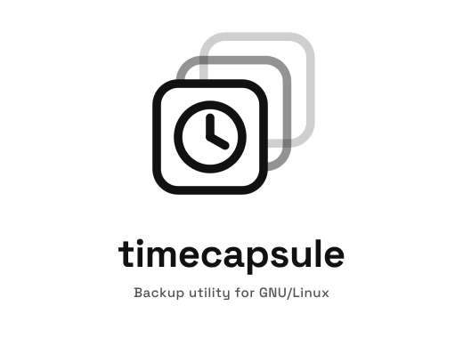

<p align="center">
  <picture>
    <source media="(prefers-color-scheme: dark)" srcset="assets/logo-dark.svg">
    
  </picture>
</p>

# Time Capsule (`timecapsule.sh`)

A lightweight, interactive Terminal UI (`whiptail`) incremental backup and recovery utility for **GNU/Linux**. Powered by `rsync --link-dest`, **Time Capsule** creates space-efficient, hard-linked point-in-time snapshots with automatic multi-tier retention pruning and single-file or full-snapshot restoration.

---

## Features

* **Space-Efficient Incremental Snapshots:** Uses `rsync --link-dest` so unchanged files are hard-linked to the previous snapshot—every backup folder browses like a full copy while only consuming disk space for new or modified files.
* **Interactive TUI Menus (`whiptail`):** Navigate directories, inspect active configuration before running a backup, pick snapshot dates without typos, and drill into snapshots—all from the terminal.
* **Flexible Single-File or Full-Snapshot Recovery:**
  * Browse inside any historical snapshot to restore a **single file or subfolder** (as a safe `.restored` side-by-side copy, directly to its original path, or to a custom directory).
  * Restore an **entire snapshot** into a safe `RESTORE_<timestamp>` folder, a custom path, or directly over the source directory.
  * Tracks each snapshot's original source path (`.meta/`) so restores stay accurate even if you change your backup source later.
* **Three-Tier Retention Policy + Safety Floor:** Automatically prunes expired snapshots across **Daily**, **Weekly** (ISO week), and **Monthly** windows while always preserving a configurable minimum number of newest snapshots (`MIN_SNAPSHOTS`).
* **Safety & Concurrency Guards:**
  * Kernel-managed `flock` locking (both UI-level and destination-level) prevents concurrent runs from colliding.
  * Interrupted (`Ctrl-C`) or failed transfers are staged in a hidden `.inprogress_` folder that is never treated as a snapshot, and is cleaned up automatically on the next run.
  * Optional mountpoint verification (`findmnt`, enabled by default via *Require Mounted Drive*) refuses to run when the backup drive isn't mounted, so you never accidentally fill your root (`/`) partition.
  * Only folders named exactly `YYYY-MM-DD_HH-MM-SS` are ever treated as snapshots; other folders in the backup directory (e.g. `lost+found`) are never touched.

---

## Platform & Filesystem Requirements

> **Important:** Time Capsule is built specifically for **GNU/Linux** and relies on POSIX hard links and GNU userland utilities (`findmnt`, `flock`, GNU `date -d`, `realpath`, `stat`). It is **not** compatible with Windows or BSD/macOS without modification.

* **Backup Destination Filesystem:** Your backup drive **must** use a POSIX-compatible filesystem that supports hard links—such as **`ext4`**, **`btrfs`**, **`xfs`**, or **`zfs`**. Filesystems like `exFAT` or `FAT32` do not support hard links and will result in full copies for every snapshot.

### Dependencies

* `bash` (>= 4.0)
* `rsync` (>= 3.1, for `--info=progress2`)
* `whiptail` (provided by `newt` on Void/Fedora/RHEL, `libnewt` on Arch, or `whiptail` on Debian/Ubuntu)
* `util-linux` (`findmnt`, `flock`)
* `coreutils` & `findutils`

#### Installing Dependencies

* **Void Linux:**
  ```bash
  sudo xbps-install -S newt rsync util-linux coreutils findutils
  ```
* **Debian / Ubuntu / Linux Mint:**
  ```bash
  sudo apt install whiptail rsync util-linux coreutils findutils
  ```
* **Fedora / RHEL:**
  ```bash
  sudo dnf install newt rsync util-linux coreutils findutils
  ```
* **Arch Linux:**
  ```bash
  sudo pacman -S libnewt rsync util-linux coreutils findutils
  ```

---

## Installation

```bash
git clone https://github.com/gvajpai/timecapsule.git
cd timecapsule
chmod +x timecapsule.sh
```

Optionally, put it on your `PATH`:

```bash
mkdir -p ~/.local/bin
cp timecapsule.sh ~/.local/bin/timecapsule
```

---

## Usage

```bash
./timecapsule.sh        # Launch the interactive TUI
./timecapsule.sh -h     # Show help
./timecapsule.sh -v     # Show version
```

On first launch, a guided setup asks you to choose a backup source, a backup destination, and a retention policy. After that, the main menu offers:

| Menu option | What it does |
|---|---|
| **Run Incremental Backup Now** | Shows a configuration summary, then creates a new timestamped snapshot and applies the retention policy. |
| **Recover / Restore** | Restores a single file, a subfolder, or a whole snapshot (see [Restoring](#restoring)). |
| **Delete an Old Backup Snapshot** | Permanently removes one snapshot you select. |
| **Configure Backup Targets & Retention Policy** | Changes any setting; changes are saved immediately. |

> **Tip:** Run Time Capsule as the same user every time. Mixing `sudo` runs and normal-user runs on the same backup directory creates root-owned files that your normal user cannot later manage.

---

## Configuration

Settings are stored in `~/.config/timecapsule.conf`. You can change them from the **Configure** menu or edit the file directly.

| Setting | Default | Meaning |
|---|---|---|
| `SOURCE_DIR` | `$HOME` | Directory to back up. Cannot be `/`. |
| `BACKUP_DIR` | `/mnt/backup/snapshots` | Where snapshots are stored. Cannot be inside `SOURCE_DIR`. |
| `REQUIRE_MOUNT` | `yes` | If `yes`, refuse to run unless `BACKUP_DIR` is on a separately mounted filesystem (not `/`). Set to `no` for backups to a local folder. |
| `KEEP_DAILY_DAYS` | `7` | Keep **every** snapshot up to this many days old. |
| `KEEP_WEEKLY_DAYS` | `56` | Beyond the daily window, keep the newest snapshot of each ISO week up to this many days old. |
| `KEEP_MONTHLY_DAYS` | `365` | Beyond the weekly window, keep the newest snapshot of each calendar month up to this many days old. |
| `MIN_SNAPSHOTS` | `3` | Always keep at least this many of the newest snapshots, regardless of age. |

### Retention Policy

After each successful backup, every snapshot is checked from newest to oldest:

1. The newest `MIN_SNAPSHOTS` snapshots are always kept.
2. Snapshots up to `KEEP_DAILY_DAYS` old are all kept.
3. Snapshots up to `KEEP_WEEKLY_DAYS` old: one per ISO week (the newest) is kept.
4. Snapshots up to `KEEP_MONTHLY_DAYS` old: one per calendar month (the newest) is kept.
5. Everything older is deleted.

With the defaults, you keep every backup from the last week, one per week for about two months, and one per month for a year.

### Default Exclusions

The following patterns are excluded from every backup. To change them, edit the `RSYNC_EXCLUDES` array near the top of `timecapsule.sh`.

| Pattern | Reason |
|---|---|
| `.cache/` | Application caches (regenerated automatically) |
| `.Rproj.user/` | RStudio per-user project state |
| `RESTORE_*/`, `*.restored` | Time Capsule's own restore output |
| `*.tmp`, `*.temp` | Temporary files |
| `*.bak` | Backup copies made by editors and other tools |
| `*.swp`, `*.swo`, `*~` | Editor swap and backup files |
| `.DS_Store`, `Thumbs.db` | macOS / Windows folder metadata |

> **Note:** `*.bak` and `.Rproj.user/` may not suit everyone. Remove them from the list if you want those files backed up.

---

## Restoring

Choose **Recover / Restore**, pick a snapshot date, then choose a scope:

**Single file or subfolder** — browse inside the snapshot and pick an item, then choose where it goes:

* **SAFE_COPY** — restored next to the original as `<name>.restored` (nothing is overwritten).
* **ORIGINAL** — restored to its original path (asks for confirmation if it already exists).
* **BROWSE** — restored into any folder you choose or type.

**Entire snapshot:**

* **SAFE** — restored to `<source>/RESTORE_<timestamp>/`.
* **BROWSE** — restored into any folder you choose.
* **OVERWRITE** — restored directly over the original source directory.

Restores never delete anything at the destination: files that exist now but were not in the snapshot are left in place, and existing files with the same name are replaced by the snapshot version.

Snapshots are also ordinary folders, so you can always browse them with a file manager or copy files out manually with `cp -a`.

---

## Backup Directory Layout

```text
/mnt/backup/snapshots/
├── 2026-11-18_21-04-12/      # snapshot (full directory tree, hard-linked)
├── 2026-11-19_20-58-40/
├── 2026-11-20_08-45-05/
├── latest -> 2026-11-20_08-45-05
├── .meta/                    # one file per snapshot recording its source path
├── .timecapsule.lock         # destination lock file
└── backup.log                # history of backups, restores, prunes, deletions
```

Because unchanged files are hard links, deleting a snapshot only frees the space used by files that exist in that snapshot alone. To see real disk usage across all snapshots:

```bash
du -sh /mnt/backup/snapshots
```

---

## Exit Codes from `rsync`

| Code | Meaning | Time Capsule's handling |
|---|---|---|
| `0` | Success | Snapshot kept |
| `24` | Some source files vanished during transfer (normal when backing up a live `$HOME`) | Snapshot kept |
| `23` | Some files could not be read (e.g. permissions) | Snapshot kept, warning shown and logged |
| Other | Real failure | Partial snapshot removed, error logged |

---

## Limitations

* Interactive only — there is no unattended mode for `cron` or `systemd` timers yet.
* Local and mounted drives only (no SSH/remote destinations).
* Backing up the whole system (`/`) is not supported.
* Permissions, ownership, timestamps, symlinks, and hard links are preserved; ACLs and extended attributes are not.

---

## Uninstalling

Delete the script and its configuration file:

```bash
rm ~/.local/bin/timecapsule        # only if you copied it there
rm ~/.config/timecapsule.conf
```

Your snapshots are plain folders and remain untouched in your backup directory.

---

## License

Released under the [MIT License](LICENSE).
